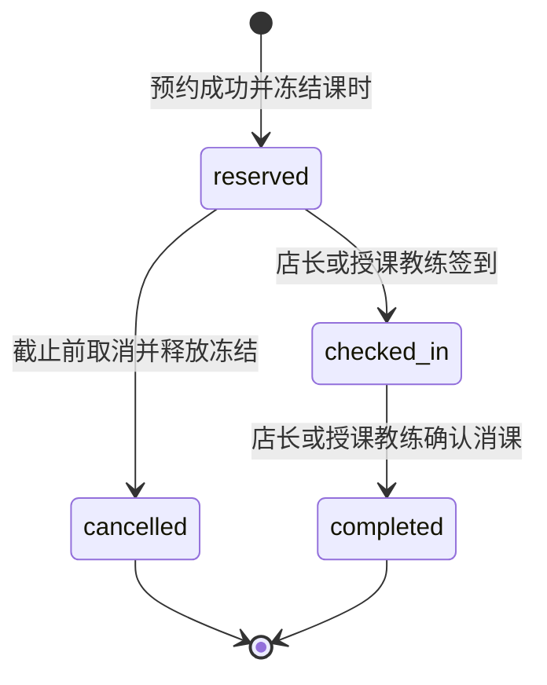

# 练多多四端产品设计

练多多服务连锁培训品牌，把总部规则、门店排课、教练履约和学员课时连接起来。首版围绕“预约冻结课时、到店签到、完成消课、跨店内部记账”形成可验证的业务闭环，并提供平台运营、总部、店长、教练、学员五个身份，覆盖原型的四个端。

当前交付定位为私有业务体验空间。每位登录者拥有独立的示例数据，切换身份是在自己的空间中体验不同权限。真实品牌组织、员工账号、微信小程序、支付、资金划转和证书核验属于后续接入范围。

## 产品范围

| 端 | 使用者 | 首版主要工作 |
| --- | --- | --- |
| 平台运营 | SaaS 运营人员 | 创建和维护品牌租户、处理品牌入驻申请、发布系统公告、查看操作记录 |
| 连锁总部 | 品牌管理员 | 汇总经营数据、查看门店排行、下发门店任务、确认跨店内部结算单 |
| 门店工作台 | 店长 | 排课、邀请和审核教练、管理本店预约、签到消课、完成总部任务 |
| 教练工作台 | 教练 | 查看本人课表和授课学员、办理本人课程签到与消课 |
| 学员约课 | 成人学员或监护人 | 切换绑定学员、查看适用课时卡、选择门店和课程、预约与取消、查询履约状态 |

原型中的支付进件改为品牌入驻资料审核。审核通过只改变业务申请状态，不表示已获得微信商户号。示例课时卡只用于演示预约和消费过程；首版不销售真实课时卡。

## 身份与数据范围

体验空间的拥有者身份来自托管环境提供的登录信息。平台、总部、店长、教练、学员是服务端固定的业务身份，浏览器只能选择已有身份，不能自行提交角色权限或组织范围。

| 操作 | 平台运营 | 总部 | 店长 | 教练 | 学员 |
| --- | --- | --- | --- | --- | --- |
| 维护租户与入驻申请 | 全体验空间 | 不允许 | 不允许 | 不允许 | 不允许 |
| 查看经营概览 | 租户层汇总 | 本品牌 | 本门店 | 本人授课 | 本人及绑定孩子 |
| 创建课程 | 不允许 | 本品牌 | 本门店 | 不允许 | 不允许 |
| 邀请或审核教练 | 不允许 | 本品牌 | 本门店 | 不允许 | 不允许 |
| 创建学员预约 | 不允许 | 本品牌 | 本门店 | 不允许 | 本人及绑定孩子 |
| 签到与消课 | 不允许 | 本品牌 | 本门店 | 本人课程 | 不允许 |
| 确认跨店结算 | 不允许 | 本品牌 | 不允许 | 不允许 | 不允许 |
| 下发门店任务 | 不允许 | 本品牌 | 不允许 | 不允许 | 不允许 |
| 完成门店任务 | 不允许 | 本品牌 | 本门店 | 不允许 | 不允许 |
| 发布公告 | 全空间 | 本品牌 | 不允许 | 不允许 | 不允许 |

真实组织版本需要持久化组织成员和角色授权。一个人可同时拥有多个品牌或门店的角色，但每次请求只能在已授权范围内操作。扫码入口只提供门店上下文，不能自动取得店长身份，也不能修改已购卡的售卡门店。

本版暂停或到期品牌仍可读取存量数据，除平台维护服务状态外不能执行业务写入。真实试点应为存量履约和必要取消建立受控通道，避免服务停用后冻结学员权益。

## 核心业务对象

| 对象 | 业务含义和关键约束 |
| --- | --- |
| 品牌租户 | 订阅版本、服务状态、到期日；品牌之间的数据和卡片权益隔离 |
| 门店 | 隶属于一个品牌；售卡门店与履约门店可以不同 |
| 教练 | 隶属品牌和门店，审核通过后进入排课范围；证书资料与审核状态分别管理 |
| 学员 | 训练服务的实际接受者；家长和孩子不能共用身份混记课时 |
| 课时卡 | 绑定品牌和学员，记录售卡门店、总课时、剩余课时、冻结课时、适用课程、有效期和可用门店范围 |
| 课程场次 | 门店、教练、教室、起止时间、容量、消耗课时；场次是预约的最小履约单位 |
| 预约 | 绑定学员、场次和课时卡；保存预订、签到、完成、取消时间 |
| 跨店结算单 | 关联唯一预约，记录售卡门店应付、履约门店应收和确认状态 |
| 总部任务 | 有明确执行门店、截止日、优先级和完成状态 |
| 公告 | 区分平台或品牌范围，以及员工、学员受众 |
| 操作记录 | 保存操作者、时间、业务动作和对象，便于解释课时与单据变化 |

首版的监护关系使用固定示例绑定，真实亲属关系申请、解绑、授权撤销和身份核验留待账号体系接入。

## 排课规则

店长在本店选择审核通过的教练、课程类型、教室、起止时间、容量和消耗课时。课程结束必须晚于开始，容量和课时均为正整数。金额统一按整数分保存，界面转换成人民币元。

本版只能为教练所属门店排课。同一教练或同一门店的同一教室不能有时间重叠的有效课程。时间区间按 `[开始时间, 结束时间)` 判断，因此上一节 15:00 结束、下一节 15:00 开始可以成立。后续跨店授课需增加门店授权及相应时间冲突检查。

证书审核只说明门店对提交资料作出了业务审核。教练记录保留证书到期日，排课和预约均应确认资质覆盖开课日期。真实实名认证、证书真实性查询和分课程证书要求，需要分别接入对应服务，不能根据证书名称推断证书真实性。

## 预约与履约状态

预约成功前，服务端必须同时检查品牌和门店状态、学员权限、卡片归属、卡片状态、适用课程、门店范围、有效期、可用课时、场次容量，以及学员在该时段是否已经有其他有效预约。通过后再写入预约和冻结课时，任何一个检查失败都不改变数据。

课时卡的“剩余”包括已冻结但尚未消费的课时。“可约”课时等于剩余减去冻结。预约冻结 1 节后，剩余不变、冻结增加 1、可约减少 1。取消时只释放冻结；完成时剩余与冻结各减少 1。不得在预约和完成两个步骤分别重复扣减剩余课时。

学员只能在开课前 60 分钟以前取消。判定条件为当前时间严格早于 `开课时间 − 60 分钟`，到达截止时间后关闭自助取消。迟到取消、旷课扣课、门店停课和消课冲正需要独立的管理流程，首版不把它们隐式归为“完成”。签到与消课只允许店长及实际授课教练执行，完成后再次提交必须保持原结果。

签到窗口为开课前 2 小时至结束后 2 小时，消课须在开课后由工作人员确认。有效期日期按上海时间计算，到期当日仍有效；卡片与教练资质均检查开课日期。已签到或已完成的预约不能再走普通取消。取消和完成都是终态；纠错应采用有原因的冲正记录，不直接改写历史流水。

## 跨店内部记账

卡片的售卡门店收取了预付权益，履约门店实际提供服务。完成消课时，如果两者不同，就为该预约生成一条内部结算记录；同店消课不生成跨店记录。重复完成同一预约不能重复生成单据。

首版按课时卡保存的单节结算价值 `unitValueCents` 乘以实际消耗课时生成单据，不使用课程当前标价。示例卡的单节价值预先配置；真实售卡后需要从订单实付额和课时分配规则取得，并保留规则快照。赠送课时、折扣、跨店服务差价和加盟店分配比例必须有明确规则。

总部确认后，单据从“待确认”变为“已确认”。这个状态只表示内部账务认可，不表示银行或微信已转账。后续资金结算应另外记录支付渠道、外部交易号、付款金额、付款状态和对账结果。

## 指标口径

| 指标 | 口径 |
| --- | --- |
| 品牌和门店数量 | 当前空间可见且符合所选状态的记录数 |
| 今日课程 | 所选门店当日开始的有效场次，不等同于预约人数或消课节数 |
| 预约人数 | 场次中未取消的预约数量；完成履约后仍保留预约历史 |
| 冻结课时 | `reserved` 与 `checked_in` 预约占用、尚未消费的课时 |
| 已消课时 | 完成预约的课时合计，按完成时间或上课日期统计时需注明所用字段 |
| 课时履约金额 | 完成预约课时乘以所用卡的单节结算价值，仅用于体验经营分析 |
| 跨店待确认金额 | 状态为 `pending` 的内部结算金额合计 |
| 跨店已确认金额 | 状态为 `confirmed` 的内部结算金额合计，不等同于已付款 |
| 活跃学员 | 生产口径为近 30 日至少完成一节课的去重学员；未实现前不将学员总数标成活跃人数 |
| 续费率 | 需要到期权益群体和续费订单，首版不凭示例数推导真实续费率 |
| MRR | 需要有效订阅合同和月度摊销；年费除以 12 只是订阅计算规则的一部分，不代表当月收款 |

概览、门店排行和明细必须使用同一数据源、筛选范围与时间区间。指标卡需要区分示例履约额、真实收款、退款和应收，避免把课时消费当成现金收入。环比、全国对标和智能诊断只有在具备相应历史和比较数据时才展示。

## 外部服务接入边界

| 能力 | 当前边界 | 后续接入条件 |
| --- | --- | --- |
| 登录 | 托管登录或仅本机启用的开发身份 | 微信用户、员工邀请、账号绑定、真实组织授权 |
| 微信小程序 | 响应式网页体验 | AppID、发布主体、用户授权流程与小程序包 |
| 支付与退款 | 无真实交易；示例课时卡 | 商户进件、支付和退款回调验签、订单幂等、金额校验、对账 |
| 跨店结算 | 生成和确认内部记录 | 品牌及加盟协议、分配规则、外部付款与对账 |
| 证书与实名 | 门店人工审核示例资料 | 实名服务、授权、资料存储和证书查询接口 |
| 通知 | 应用内公告和任务 | 订阅授权、消息服务、发送结果和失败重试 |
| 课堂照片和成长报告 | 后续项 | 监护授权、对象存储、访问权限、删除与撤销策略 |

不得对学员展示“平台担保退款”“支付已直达商户”“已完成微信实名”或“资金不经过平台”等尚未由实际服务链路证明的承诺。退款资格、时限和费用应随真实商品条款明确，并在下单时保留条款版本。

## 本版实现与后续范围

| 状态 | 能力 |
| --- | --- |
| 本版实现 | 拥有者独立空间、固定身份及服务端范围校验、品牌资料与入驻审核、教练邀请及资料审核、同店排课、课时预约冻结与取消、签到消课、跨店内部记账与确认、总部任务、公告、操作记录 |
| 待外部接入 | 真实微信身份与小程序发布、商户支付退款、实际资金划转、证书真实性查询、订阅消息、资料文件存储 |
| 后续产品 | 真实组织成员授权、课时卡订单、课程停课与改课、迟取消审批、旷课处理、冲正、真实监护关系、加盟分配、完整财务对账 |

首版邀请产生体验邀请码和待审核记录，没有向真实教练发送邀请，也没有教练自助上传资料流程。资料不完整的邀请记录不能直接通过审核。界面和接口能力的执行结果按验收标准分别验证。

## 后续产品顺序

下一阶段先完成真实组织成员、课时订单与退款、学员和监护关系、消课冲正和停课处理，再接入微信登录、商户支付与通知。之后再扩展候补、改课、周期排课、加盟分配规则、训练档案和营销推荐。

投入真实门店试点前，应把目前固定身份的体验权限替换为真实组织授权，并将结算和操作记录迁移为可以逐笔核对的独立记录。批量经营、照片和未成年人资料功能不应先于身份与访问控制上线。
